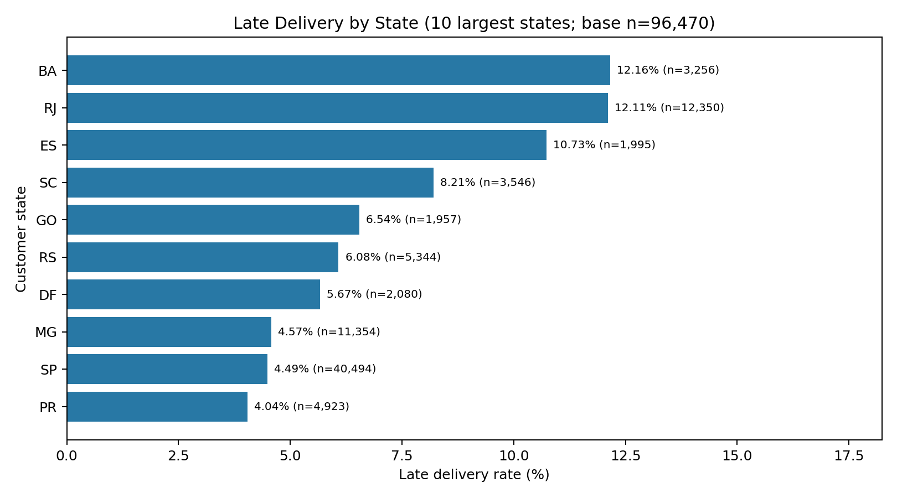
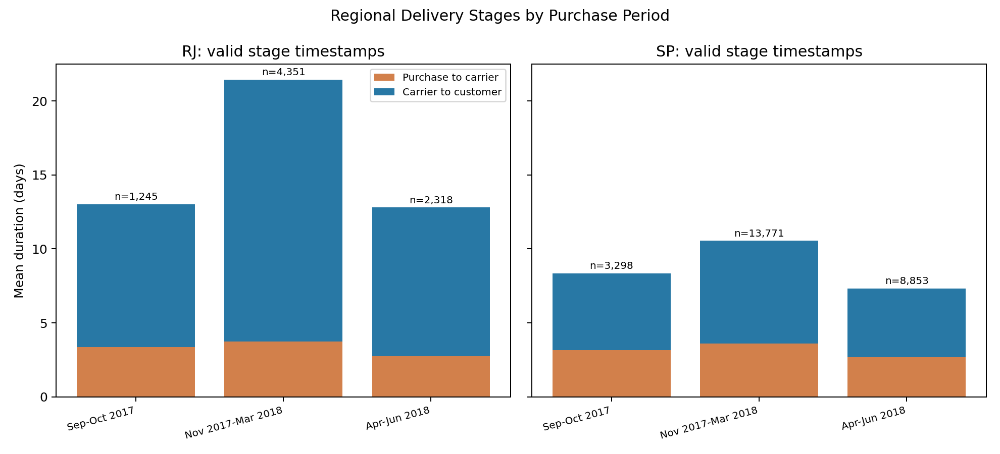
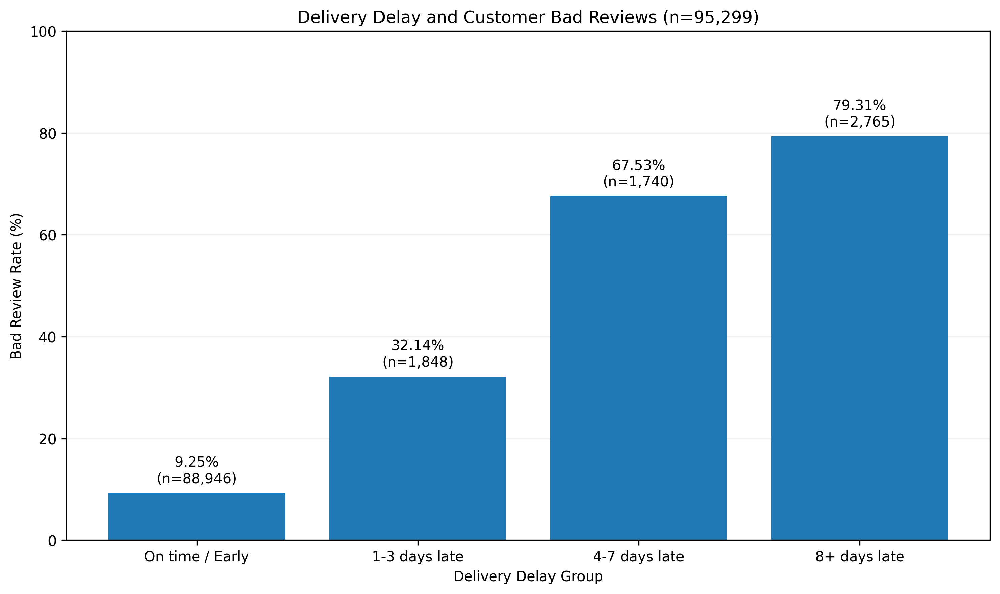
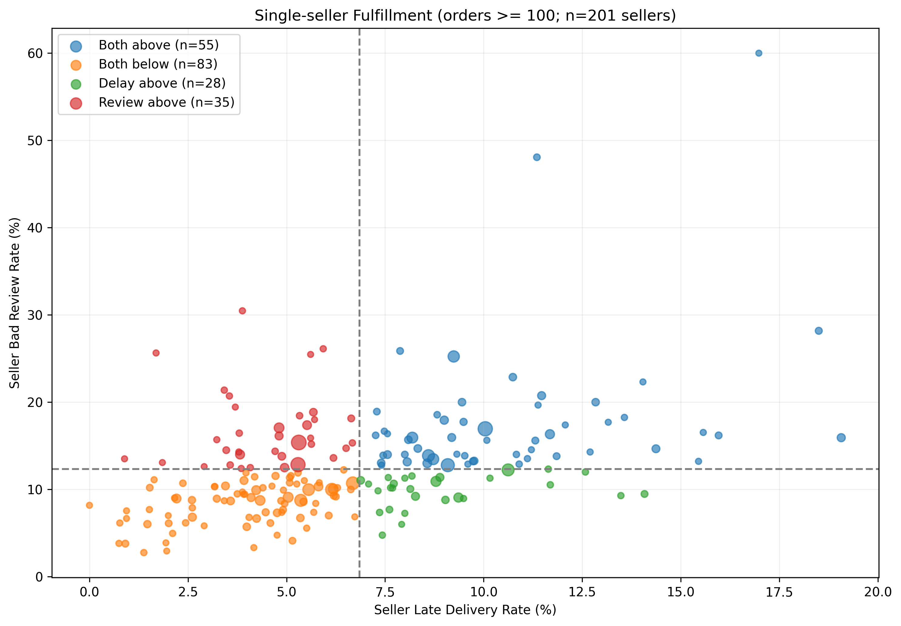
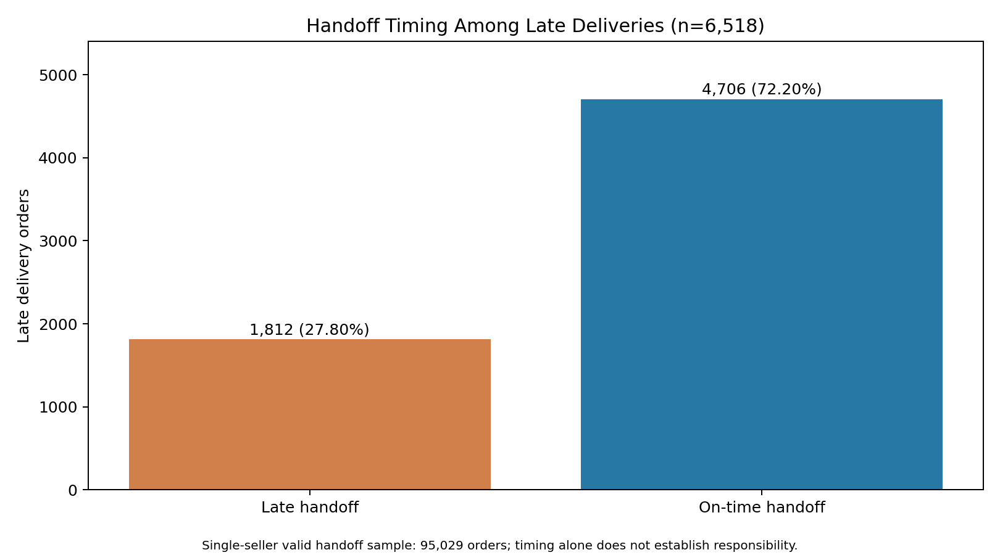
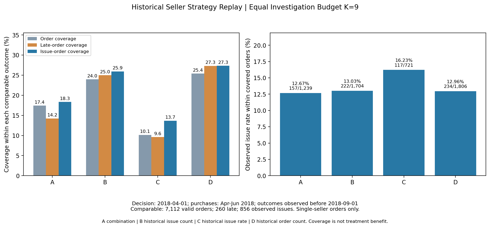

# Olist 电商订单履约风险诊断与客户体验分析

Olist 帮助巴西商家接入线上销售渠道。消费者下单后，卖家备货并交给物流合作伙伴配送。一笔订单可能包含多个卖家的商品，而系统记录的准时签收只反映订单状态。消费者是否按承诺日期收到商品、是否收齐，以及体验如何，需要结合不同记录判断。

项目使用 Olist 2016—2018 年巴西电商公开历史数据，回答三个业务问题。

- 哪些地区和时期的配送问题更集中，耗时增加主要发生在哪个环节？
- 超过承诺日期与差评有什么关系，准时订单还暴露了哪些体验问题？
- 当调查资源有限时，哪些卖家值得优先核查，应从哪里查起？

[完整业务分析报告](docs/analysis_journey.md)串起原始分析的判断过程。[卖家策略比较](docs/seller_decision_case.md)是后续扩展，比较相同调查名额下四种筛选方式的取舍。

## 配送问题集中在哪里

有效已交付订单的延迟率为 **6.77%**。要决定从哪个地区查起，需要同时看延迟比例和涉及的订单数量。



SP 的延迟率为 **4.49%**，但由于订单量大，延迟订单最多。RJ 的延迟率为 **12.11%**，同时有 1,495 笔延迟订单。RJ 兼具较高比例和较大规模，值得继续按时期拆开看。

## RJ 的配送在哪个环节变慢

RJ 的高延迟集中在 2017 年 11 月至 2018 年 3 月。对照 SP，并把配送拆成下单到交运、交运到签收，可以看到变化主要发生在哪个环节。



RJ 交运后平均耗时由 **9.66 天**增至 **17.70 天**，交运前变化较小。进一步拆分发现，RJ 的异州订单占比没有上升，变慢的是异州订单交运后的配送。SP 来源订单是优先核查对象，具体运输环节和责任仍需结合轨迹与交接记录确认。

## 晚到多久与客户差评有关

配送耗时解释了订单在哪个环节变慢，评价可以反映客户如何看待这次购物。按超过承诺日期的天数分组，可以看到轻微和严重超期是否对应不同的差评表现。



准时订单差评率为 **9.25%**，延迟 1—3 天为 **32.14%**，延迟至少 8 天为 **79.31%**。合并来看，延迟组差评率为 **62.36%**，考虑地区和月份后关联仍然存在。准时订单也可能收到低分。原报告在两件商品的单卖家和双卖家订单中都发现了少件线索，提示调查还需关注商品交付完整性。这些结果属于观察性比较。

## 哪些卖家值得优先调查

延迟和差评反映不同方面的问题。将两者放在同一张图上，可以看出哪些卖家两项都偏高，再结合订单规模判断调查可能覆盖多少问题。



在达到历史订单量门槛的 201 名卖家中，有 55 名的两项比例均高于整体基准。对这批卖家分别按问题订单数量和占比取前五，再去重，形成完整历史的 **9 名调查候选**。数量对应调查覆盖面，占比有助于发现问题较集中的卖家。

## 入选后先查交运还是配送

最终延迟只说明没有兑现送达承诺。对照规定交运截止时间与实际交接时间，可以区分订单在交运时是否已经超期。



在有效交运样本的最终延迟订单中，**72.20%** 已按时交运。对这类订单应沿交运后的运输和派送记录排查。交运超期突出的卖家则应优先核查备货和交接。统计结果提供调查方向，责任归属仍需查证。

## 相同调查名额下如何比较筛选策略

完整历史可以形成调查名单。为了比较名单在后续订单中的覆盖表现，扩展分析按历史时间切分，用同样的 **9 个调查名额**比较四种筛选方法。



按历史订单量排序覆盖的问题订单最多，共 **234 笔**。按历史问题占比排序的名单所覆盖订单中，问题率最高，为 **16.23%**。原组合规则在这次比较中没有胜出。两个指标分别对应覆盖更多问题与寻找问题更集中的对象。这里的 9 名额来自独立时间切分，结果仅反映回顾性比较。

各模块的样本、分母、图表解读和调查建议见[完整业务分析报告](docs/analysis_journey.md)。指标定义和筛选口径见[方法与指标](docs/methodology.md)。四策略的时间窗口与限制见[完整业务决策报告与样本审计](docs/seller_decision_case.md)及[策略结果 CSV](outputs/seller_strategy_comparison.csv)。

数据来自 [Olist Brazilian E-Commerce Public Dataset](https://www.kaggle.com/datasets/olistbr/brazilian-ecommerce)，原始数据许可为 CC BY-NC-SA 4.0。技术栈为 MySQL 8+ 和 Python，依赖见运行说明。

## 如何运行

已验证环境、建库导入、SQL执行、数据导出和测试命令见[数据准备与完整运行顺序](docs/data_setup.md)。使用正式版Python的独立虚拟环境，原始数据与凭据保存在本地。

```powershell
python -m unittest discover -s tests -v
```

默认运行会执行 9 项测试，并跳过 4 项需要专用 MySQL 实例的测试。配置好隔离测试库、专用连接凭据及 `OLIST_TEST_DB_NAME` 后，才可执行全部 13 项，配置方法见[数据库测试说明](docs/data_setup.md#时间切分策略与测试)。

固定公开数据版本的额外核验通过 `OLIST_VERIFY_REFERENCE=1` 启用。SQL、Python各步骤的实际执行结果和局限见[质量修复报告](docs/quality_review.md)。首次准备阶段的验证事实见[历史核验记录](docs/validation.md)和[报告核验对照](docs/report_reconciliation.md)。

## 文件导航

| 目录 | 内容 |
| --- | --- |
| `sql/` | 数据导入、平台/地区/评价/卖家/交运与金额分析、三份导出查询 |
| `python/` | MySQL 导出、可视化、统计模型、卖家筛选及交运合并 |
| `figures/` | 原有五张分析图与一张卖家策略比较图 |
| `outputs/` | 经检查的订单或卖家汇总成果，含展示编号候选表 |
| `docs/` | 指标口径、复现说明、审计与安全检查、报告结果对照 |

仓库不包含原始 CSV、订单级导出、客户信息、评论原文、个人配置或内部 Word 报告。数据与衍生汇总来源及许可说明见 [DATA_LICENSE.md](DATA_LICENSE.md)。
