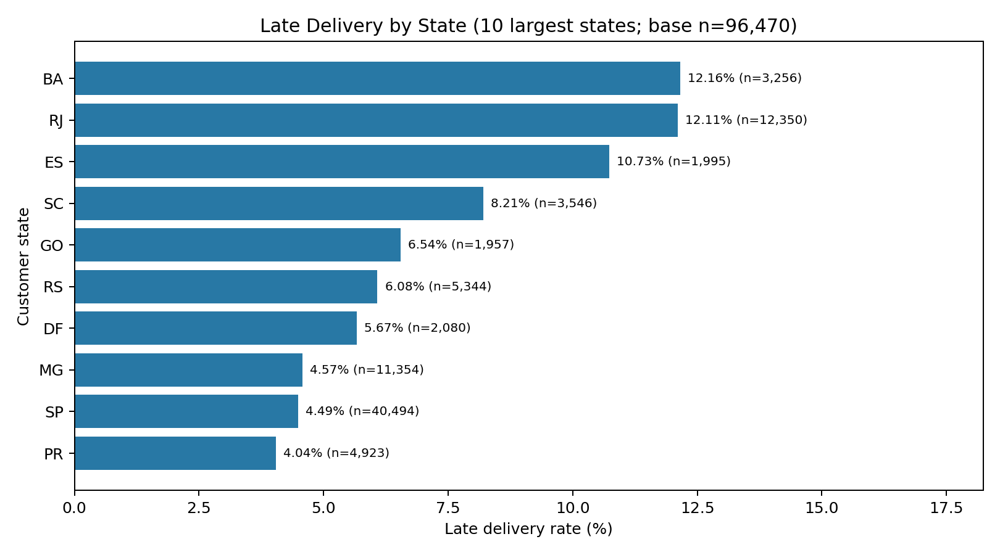
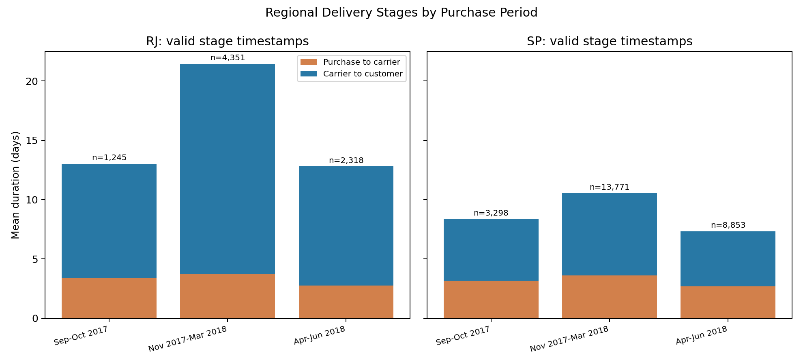
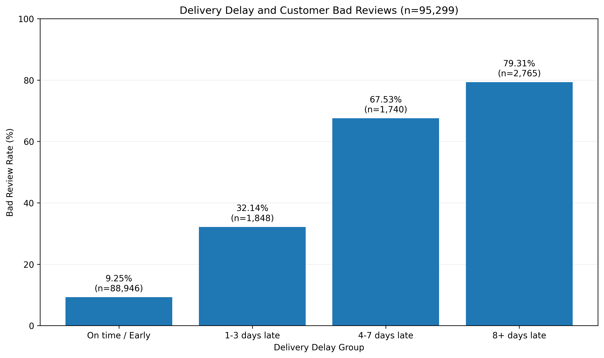
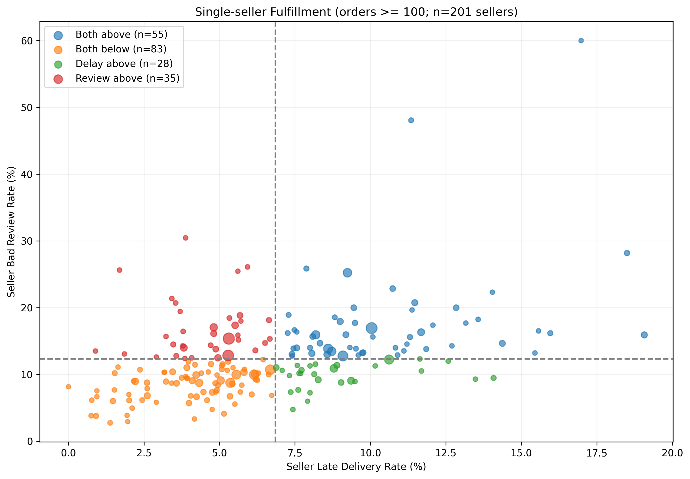
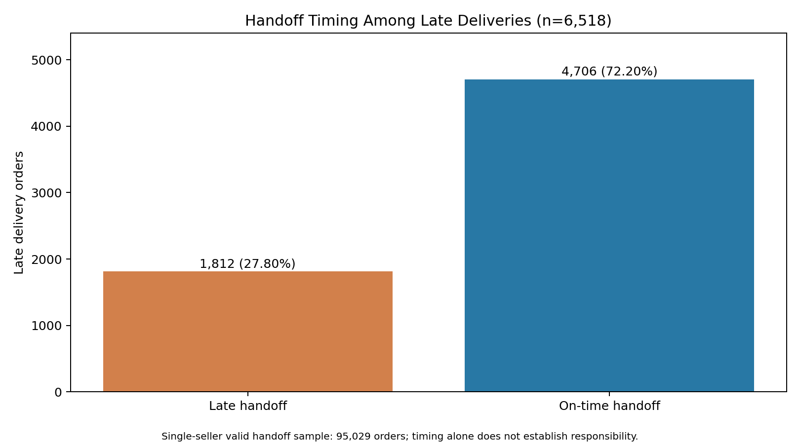

# Olist 电商订单履约风险诊断与客户体验分析

Delivery performance, customer reviews and seller investigation priorities in the Olist dataset.

项目基于 Olist 2016—2018 年巴西电商公开历史数据，关注**配送问题集中在哪里、这些问题与客户评价有什么关系，以及调查资源有限时应优先检查哪些卖家**。分析从订单配送表现出发，结合客户评价筛选调查对象，再比较不同筛选方案的取舍。

## 业务分析路径

1. **确认配送表现**：先检查订单状态、缺失日期和时间先后关系，再计算配送时长及超过承诺日期的订单比例，保证比较建立在有效记录上。
2. **定位问题集中的地区和时期**：同时比较延迟数量和延迟率，再按月份、配送阶段和卖家所在州拆分，判断后续调查应从哪里入手。
3. **了解配送与客户评价的关系**：将评价整理到每笔订单，比较不同超期程度的差评率，检查不同评价处理规则下结果是否一致，并用 Logistic 回归考虑地区和月份差异，检查关联是否仍然存在。
4. **筛选值得调查的卖家**：结合延迟、差评和订单规模形成名单，再检查交运情况，区分需要核查的环节。名单形成后，还要与其他筛选方案比较，才能判断它更适合什么目标。
5. **补充商品交付的完整性**：检查准时订单中的商品数量与卖家结构，了解订单级签收状态能否充分反映客户的收货体验。

## 主要发现与业务含义

### 1. 延迟集中在长尾订单，地区调查需要同时看规模和比例

客户等待的时间既有整体水平，也有少数明显偏慢的订单。有效已交付订单平均配送 **12.56 天**，中位数为 **10.22 天**，P90 为 **23.10 天**；其中 **6,534 笔延迟，延迟率为 6.77%**。配送时长达到 21 天的订单占 12.96%，却集中了 86.04% 的延迟订单，说明有必要进一步调查这部分等待较久的订单。

地区比较需要同时看问题数量和比例。SP 有 40,494 笔有效订单、1,820 笔延迟，延迟率为 **4.49%**；RJ 有 12,350 笔有效订单、1,495 笔延迟，延迟率为 **12.11%**。SP 涉及的订单规模更大，而 RJ 在延迟比例较高的同时，也有较多延迟订单，值得进一步按时期拆分。



### 2. RJ 的问题需要沿月份与交运后阶段继续追查

地区总体差异还不能说明问题是否持续存在。2017 年 11 月至 2018 年 3 月，RJ 的 4,351 笔有效订单中有 1,150 笔延迟，延迟率为 **26.43%**。在时间顺序有效的阶段样本中，交承运方后平均耗时由前期的 **9.66 天**增至 **17.70 天**，交承运方前则由 3.35 天增至 3.74 天。耗时增加主要出现在交运后，调查可优先查看这一时期的目的地、运输链路和承诺时限，但这些结果还不能确定具体责任方。

图中前期为 2017 年 9—10 月，高延迟期为 2017 年 11 月—2018 年 3 月，后期为 2018 年 4—6 月；每根柱标注各自阶段有效样本量。



### 3. 延迟越严重，观察差评率越高

配送表现是否也反映在客户评价上？在 95,299 笔单条有效评价订单中，延迟订单差评率为 **62.36%（3,962 / 6,353）**，准时订单为 **9.25%（8,227 / 88,946）**。按超期程度细分后，延迟 1—3 天、4—7 天及 8 天以上的差评率分别为 **32.14%、67.53%、79.31%**。差评率随超期程度增加，说明配送履约值得纳入客户体验调查。

| 统计量 | 估计值 | 95% 置信区间 |
| --- | ---: | --- |
| 未调整差评率差 RD | 53.11 个百分点 | 51.90—54.31 个百分点 |
| 未调整风险比 RR | 6.74 | 6.56—6.93 |
| 调整后优势比 OR | 14.78 | 13.94—15.66 |

地区和月份可能同时影响配送与评价，因此回归进一步考虑了客户所在州和下单月份；同一客户可能有多笔订单，标准误按 `customer_unique_id` 聚类处理。调整后，延迟与差评仍存在明显关联。表中的 OR 是优势比，不能理解为差评概率增加 14.78 倍；未调整 RD/RR 区间未按客户聚类。这些结果仍是**观察性关联**，尚未考虑商品质量、价格、卖家服务等全部可能影响评价的因素。



### 4. 用问题规模与比例形成卖家调查名单，再区分环节

平台层面的关联还不足以决定具体调查谁。以单卖家样本的订单加权延迟率 **6.85%**、有效评价差评率 **12.33%** 为探索基准，201 名至少有 100 笔订单的卖家中，有 55 名的两项指标都偏高。再分别取问题订单数量前 5 名和问题占比前 5 名，去重后得到 **9 名优先调查候选卖家**。问题订单指延迟或差评的订单，同时满足两项的只计一次。

最低订单量会影响哪些卖家有机会入选。门槛提高至 150 笔后，原名单有 8 人保留；降至 50 笔后，有 7 人保留。这说明多数候选在门槛变化后仍会入选，但也有变化，不能据此认定 100 笔就是最优门槛。



找到候选卖家后，还需要区分问题可能出现的环节。95,029 笔有效交运订单中，有 6,518 笔最终延迟，其中 **4,706 笔（72.20%）已按时交运**，提示交运后的配送过程也应检查。另一方面，交运超期组的最终延迟率约为 20.94%，按时交运组约为 5.45%，交运时效同样值得关注。

金额用于补充说明问题涉及的交易规模：单卖家样本中，14,165 笔问题订单涉及商品金额及运费合计 **R$ 2,564,540.84**。这**不代表实际损失、退款或可挽回收益**。公开候选表使用展示编号，不包含订单和客户明细。



### 5. 准时送达不能完整代表商品交付体验

准时订单中也有差评，因此仅检查配送速度还不够。88,946 笔准时且有单条有效评价的订单中，单商品单卖家、多商品单卖家、多商品多卖家的差评率分别为 **7.53%、20.99%、47.17%**。进一步限定为恰好两条商品明细后，单卖家组为 **19.69%（1,173 / 5,956）**，双卖家组为 **45.68%（423 / 926）**，说明商品数量和卖家结构也值得纳入调查。

少量人工阅读的评论提到了部分未收货、少件、错发等情况，为调查商品交付完整性提供了线索。但这些评论没有形成可复现的全量分类，不能据此推算总体投诉占比或确定差评原因。后续需要结合商品及包裹记录，核查订单级签收状态与实际收货体验是否一致。

## 业务决策案例：9个调查名额，应该先查谁？

调查名额有限时，筛选规则还需要回答一个实际问题：选中的卖家能涉及多少后续问题订单？本次以2018-04-01为决策日，使用此前已送达的订单和按记录时间已可用的评价，在相同130名合资格卖家中比较四种方案。组合规则实际选出K=9，其余方案也各选9名；后续订单数、评分和总体阈值均未用于选人。

后续4—6月的订单统一观察至9月1日，满足条件的共同样本有7,112笔订单，其中856笔为问题订单。**按历史订单量排序覆盖234笔问题（27.34%），按问题数量排序覆盖222笔（25.93%），原组合规则覆盖157笔（18.34%），按问题占比排序覆盖117笔（13.67%）**。问题占比策略覆盖的数量较少，但所覆盖订单的问题率最高，为16.23%。

组合规则在本次比较中没有胜出。结果说明，优先覆盖更多问题订单和优先寻找问题比例突出的卖家，是两种不同的调查目标；问题订单涉及的金额也不能当作经济收益。

这项比较属于**按事件发生时间限制信息使用的历史回顾**。数据没有保留各字段的修改记录，无法完整还原决策当日的数据，因此不能据此证明预测优势或真实改善。原完整历史筛出的9人名单与本次K=9来自不同样本，不能混为同一结果。

[完整业务决策报告与样本审计](docs/seller_decision_case.md) · [策略结果CSV](outputs/seller_strategy_comparison.csv) · [主要图表](figures/seller_strategy_comparison.png)

## 调查建议与局限

- **地区与链路**：优先检查 RJ 高延迟期的交运后时效、目的地及承诺日期变化，并兼顾 SP 的延迟订单规模。
- **卖家分场景排查**：交运超期比例高的候选核查备货和交接；已按时交运但最终延迟较多的候选核查配送链路；准时仍差评的候选补查商品一致性、完整性和售后。
- **验证业务假设**：结合包裹轨迹、售后及补发记录确认原因后，再设计小范围试点与效果评估。

这是基于公开历史数据的个人分析，未在真实企业实施干预；候选名单不构成违规认定或履约责任结论。仅分析已交付订单会遗漏未完成订单风险；评价覆盖有选择性，订单级时间戳无法反映全部包裹与商品的实际交付过程。时期划分和卖家阈值均为探索性选择。

## 数据与样本口径

数据来自 [Olist Brazilian E-Commerce Public Dataset](https://www.kaggle.com/datasets/olistbr/brazilian-ecommerce)，原始数据许可为 CC BY-NC-SA 4.0；下载与使用须遵循数据源条款。技术栈为 **MySQL 8+、Python、pandas、NumPy、Matplotlib、statsmodels、PyMySQL**。

| 分析模块 | 样本 | 筛选与分母 |
| --- | ---: | --- |
| 原始订单 | 99,441 笔订单 | 全部订单状态 |
| 整体与地区履约 | 96,470 笔订单 | 已交付；下单、收货及承诺日期有效；收货不早于下单 |
| 平台配送阶段 | 96,281 笔订单 | 另要求下单 ≤ 交承运方 ≤ 收货 |
| 延迟与差评主分析 | 95,299 笔订单 | 有效已交付订单中恰有一条非空评分评价 |
| 单卖家画像 | 95,195 笔订单、2,948 名卖家 | 每订单仅一个不同卖家；其中 94,051 笔有单条有效评价 |
| 单卖家交运诊断 | 95,029 笔订单 | 单卖家样本中交承运方时间有效且顺序合理 |

各模块回答的问题不同，使用的样本也不同。配送延迟按**收货日期晚于承诺日期**判断，差评定义为 **1—2 分**；配送耗时按秒换算为天，交运超期则比较完整时间戳。上表中的订单数、评价数和卖家数分别对应各自分母，具体定义见[方法与指标](docs/methodology.md)。

## 如何运行

环境建议：Python 3.9+、MySQL 8+。在仓库根目录运行：

```powershell
python -m pip install -r requirements.txt
# 先下载九份原始 CSV，并按 docs/data_setup.md 在全新数据库执行 SQL 00—05。
python python/01_export_order_review.py
python python/00_export_seller_tables.py
python python/02_visualize_review_delay.py
python python/03_review_statistics.py
python python/04_seller_risk_analysis.py
python python/05_seller_handoff_analysis.py
python python/06_plot_public_summaries.py
```

连接数据库时交互输入用户名和密码，或自行设置 `OLIST_DB_*` 环境变量。原始 CSV 自行从 Kaggle 下载；`data/` 和 `outputs/tables/` 均不入库。已有公开汇总表可直接用于最后一步绘图。完整顺序、SQL 导入路径配置及导出依赖见[数据准备](docs/data_setup.md)。

原项目发布核验中已复跑 Python 评价图、统计模型、卖家筛选、交运合并，并对照原始 CSV 和已有结果核验关键数字；**未实际运行 MySQL 导入、SQL 分析脚本及数据库导出步骤**。SQL 完成静态检查与已识别执行错误修复，不能等同于数据库端执行成功。详情见[核验记录](docs/validation.md)和[报告核验对照](docs/report_reconciliation.md)。

## 文件导航

| 目录 | 内容 |
| --- | --- |
| `sql/` | 数据导入、平台/地区/评价/卖家/交运与金额分析、三份导出查询 |
| `python/` | MySQL 导出、可视化、统计模型、卖家筛选及交运合并 |
| `figures/` | 原有五张分析图与一张卖家策略比较图 |
| `outputs/` | 经检查的订单或卖家汇总成果，含展示编号候选表 |
| `docs/` | 指标口径、复现说明、审计与安全检查、报告结果对照 |

仓库不包含原始 CSV、订单级导出、客户信息、评论原文、个人配置或内部 Word 报告。数据与衍生汇总来源及许可说明见 [DATA_LICENSE.md](DATA_LICENSE.md)。
