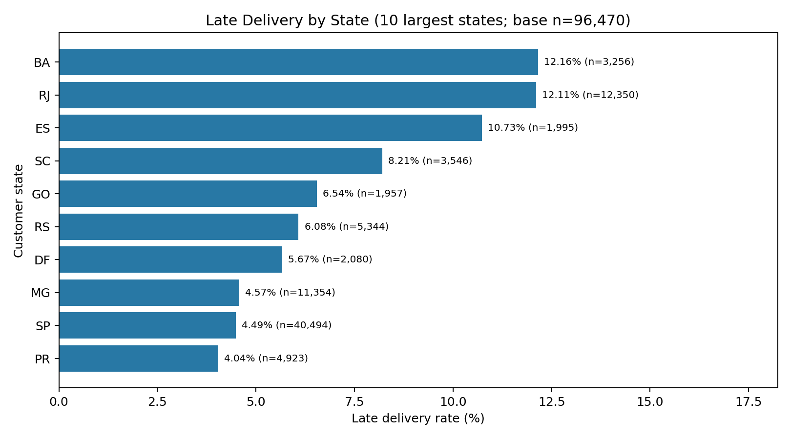
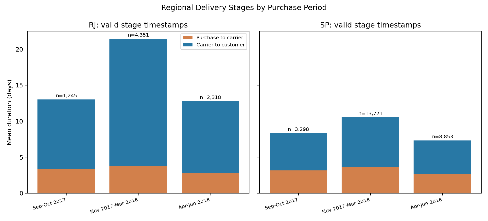
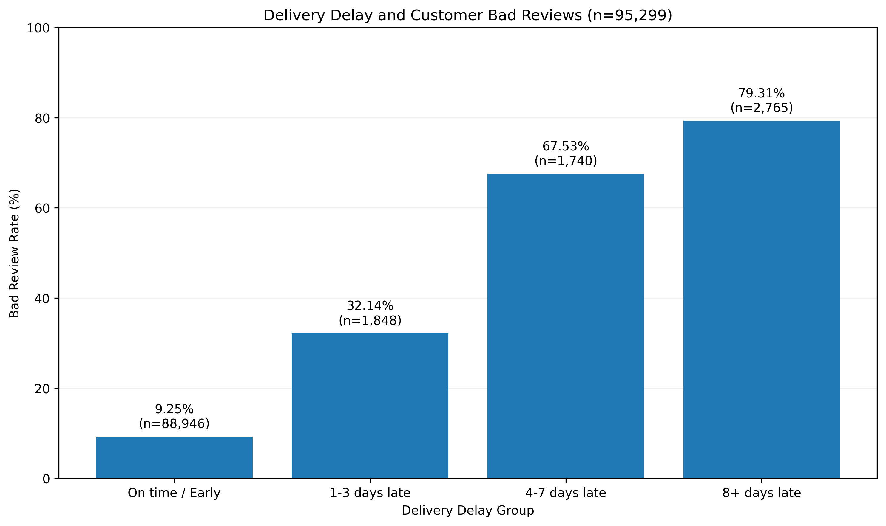
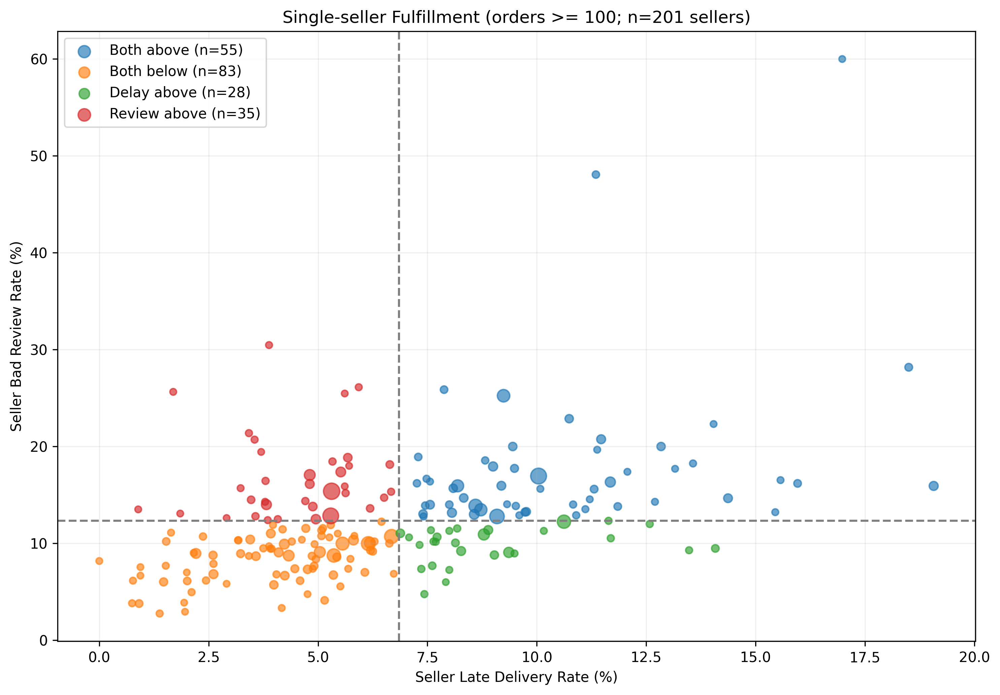
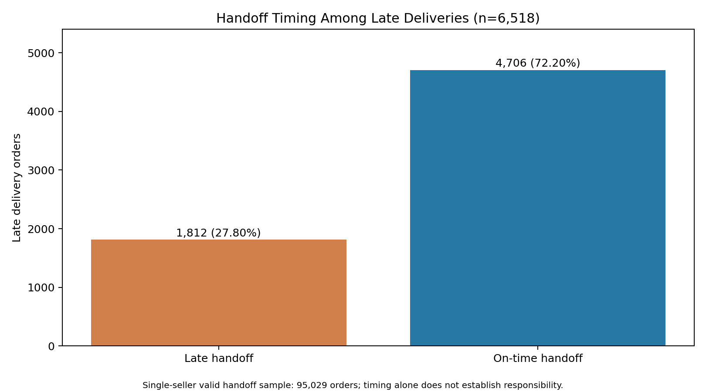

# Olist 订单履约与客户体验分析

## 从一笔平台订单理解履约问题

Olist 帮助巴西商家接入线上销售渠道。消费者下单后，卖家备货并交给物流合作伙伴，由后者完成配送。客户收到商品或临近预计送达日期时会收到满意度调查。一笔订单可以包含多件商品，也可能涉及多个卖家。因此，订单记录中的一次签收只反映订单状态，不能直接说明每件商品都已正确交付。

分析使用 2016—2018 年的公开历史订单，回答三个相连的问题：配送问题集中在哪些地区、时期和环节？延迟与客户评价有多大关联，准时订单还有哪些问题？在调查资源有限时，哪些卖家值得优先核查，应查什么？

## 确定每项指标能使用哪些订单

订单表记录状态和配送节点，商品明细记录卖家、交运截止时间、价格与运费，客户表提供收货州，评价表记录评分及调查时间。关联前先把一对多的商品或评价信息汇总到订单层面，避免一笔多件商品或多条评价的订单被重复计入。

99,441 笔订单中，96,478 笔标记为已交付，8 笔缺少收货时间。另有 6 笔已取消订单留有收货时间，状态与时间记录之间的差异没有确认原因。整体配送分析采用 96,470 笔日期有效、收货不早于下单的已交付订单。未完成和取消订单需要另行衡量，无法用已完成配送的时长代表。

拆分配送阶段还要求下单、交承运方、收货依次发生。排除 1 笔缺交运时间、165 笔交运早于下单、23 笔交运晚于收货的订单，得到 96,281 笔。交运时间倒置会破坏阶段计算，但有效的下单和签收时间仍可用于总时长。评价和卖家分析各自还有附加条件，分母见[方法与指标](methodology.md)及[数据准备](data_setup.md)。

## 客户等了多久，平台有没有兑现承诺

实际等待按下单到签收的秒数换算成天。承诺周期按下单日到预计送达日的自然日计算，是否延迟则比较签收日与承诺日，同日签收视为准时。这三个量分别对应等待、承诺和兑现。

实际配送平均 **12.56 天**，中位数 **10.22 天**，P90 和 P95 分别为 **23.10 天**和 **29.27 天**。均值无法代表较慢的一批订单。配送达到 21 天的 12,499 笔订单只占 12.96%，却包含 5,622 笔延迟，占全部延迟的 86.04%。即使配送达到 30 天，仍有 969 笔在承诺日内送达。

平均承诺周期为 24.37 天。6,534 笔订单超过承诺日，延迟率为 **6.77%**。延迟订单平均超期 10.62 天，43.80% 至少晚到 8 天。分析使用 1—3 天、4—7 天和至少 8 天区分超期程度。整体分布揭示了问题规模，进一步定位还需要比较收货地区和配送节点。见[平台 SQL](../sql/01_platform_fulfillment.sql)和[公开汇总](../outputs/platform_summary.csv)。

## 从地区差异追到 RJ 的交运后阶段

圣保罗州（SP）有 40,494 笔有效订单，1,820 笔延迟，延迟率 4.49%。里约热内卢州（RJ）有 12,350 笔有效订单，1,495 笔延迟，延迟率 12.11%。SP 的延迟数量最高，RJ 同时具有较高比例和较大问题规模。RJ 的平均实际配送与承诺周期分别为 15.31 和 27.00 天，SP 为 8.76 和 19.78 天。RJ 虽有更长的承诺周期，仍有较高延迟率。

按下单月份查看后，RJ 的高延迟集中于 2017 年 11 月至 2018 年 3 月。对照前期 2017 年 9—10 月和后期 2018 年 4—6 月，可以判断延迟上升是否伴随承诺收紧。

| RJ 时期 | 有效订单 | 延迟订单及比例 | 平均实际配送（天） | 平均承诺周期（天） |
| --- | ---: | ---: | ---: | ---: |
| 前期 | 1,245 | 75（6.02%） | 13.01 | 23.09 |
| 高延迟期 | 4,351 | 1,150（26.43%） | 21.44 | 26.63 |
| 后期 | 2,330 | 104（4.46%） | 12.79 | 32.94 |

高延迟期承诺周期延长，但实际配送变慢得更多。后期实际配送缩短、承诺周期又延长，两者都可能影响延迟率回落。阶段样本进一步显示，RJ 交运前耗时由 3.35 增至 3.74 天，交运后由 9.66 增至 17.70 天，后者增加 8.04 天。同期 SP 交运后只增加 1.75 天。RJ 后期交运后回落至 10.04 天。后期整体 12.79 天与阶段样本合计约 12.81 天来自不同筛选。

变化主要在交运后，接着检查是否有更多订单来自异州卖家。在阶段时间有效的单卖家订单中，RJ 异州占比由前期 93.06% 变为高延迟期 92.61%，后期为 91.13%。异州占比没有上升，但异州订单交运后耗时从 10.13 增至 18.89 天，延迟率从 6.32% 升至 28.56%。同期 RJ 本州卖家订单交运后耗时从 4.00 变为 3.81 天。高延迟期，SP 收货订单的异州占比为 24.10%，明显低于 RJ，两地卖家来源结构不同。

进一步按来源州拆分后，SP 卖家是 RJ 高延迟期的主要调查线索。在这一时期，RJ 的 4,302 笔有效阶段单卖家订单中，2,895 笔来自 SP 卖家（67.29%）。其中 912 笔延迟，占该样本 1,146 笔延迟的 79.58%。这批 SP 来源订单延迟率为 31.50%，交运后平均 19.36 天。同期 RJ 本州卖家订单分别为 2.52% 和 3.81 天。调查可以优先核查 SP 来源、RJ 收货的订单。这里使用卖家注册州与客户州，实际发货仓、运输路线和责任方还需独立核实。见[地区 SQL](../sql/02_regional_delivery.sql)、[时期汇总](../outputs/regional_period_summary.csv)和[阶段汇总](../outputs/regional_stage_summary.csv)。同州、异州及来源州的比较使用相同的有效阶段单卖家样本。

## 配送延迟是否反映在客户评价上

直接关联评价明细会让有多条评价的订单重复计数。96,470 笔有效已交付订单中，646 笔无评价，525 笔有多条评价，其中 189 笔评分冲突。主分析保留恰有一条且评分非空的 **95,299 笔**，评分 1—2 分记为差评。这样每笔订单只有一个清楚的评价结果，但分析仍受评价覆盖和筛选影响。

延迟订单差评率为 **62.36%（3,962/6,353）**，准时订单为 **9.25%（8,227/88,946）**。延迟 1—3 天、4—7 天、至少 8 天的差评率分别为 32.14%、67.53%、79.31%。图中各组的分母均为该组有单条有效评价的订单。多评价敏感性检查分别采用“任一有效评分为低分”和“所有有效评分均为低分”归并订单，检查主结论是否依赖冲突评分的处理方式。

两种归并规则下，延迟组差评率仍约为 62%，准时组约为 9%。这说明观察到的差距不依赖某一种多评价归并方式。延迟组缺少评价的比例也较高，因此这项检查不能排除评价缺失带来的选择偏差。

差评率差（RD）说明两组相差多少个百分点，风险比（RR）说明差评率相差多少倍。未调整的 RD 为 53.11 个百分点（95% 置信区间 51.90—54.31），RR 为 6.74（6.56—6.93）。地区和下单月份可能同时关联配送与评价，因而进一步使用 Logistic 回归纳入这两个变量，并按客户聚类估计标准误。调整后的优势比（OR）为 14.78（13.94—15.66），其含义不同于差评概率的倍数。未调整区间未按客户聚类。结果支持配送延迟和差评存在观察性关联，商品质量、价格、服务等因素尚未被充分控制，无法据此推断因果。见[评价 SQL](../sql/03_review_analysis.sql)、[统计代码](../python/03_review_statistics.py)和[评价汇总](../outputs/review_summary.csv)。

## 从卖家规模与问题类型形成调查名单

参与全部有效订单的 2,970 名卖家中，约 79% 参与不足 30 笔。直接按比例排序容易让少量订单中的偶然波动排在前面，单看问题数量则会偏向规模大的卖家。为减少多卖家订单的归属歧义，画像使用 95,195 笔单卖家订单，涉及 2,948 名卖家，其中 94,051 笔有单条有效评价。

延迟率使用有效订单作分母，差评率使用有效评价订单作分母。至少有 100 笔订单并有可用评价的 201 名卖家，覆盖 59.43% 的有效单卖家订单。图中的两条参考线分别为历史订单加权延迟率 6.85% 和有效评价差评率 12.33%。有 55 名卖家同时超过这两个基准，涉及 18.92% 的订单、27.79% 的延迟及 25.89% 的差评。

延迟或差评均记入问题订单，两者同时发生时只计一次。对双指标偏高的卖家分别取问题订单数前五名和问题占比前五名，再去重得到 **9 名调查候选**。例如 Candidate_01 有 343 笔问题订单，适合从覆盖规模考虑。Candidate_06 有 94 笔问题订单，但占其订单的 50.81%，更适合专项核查。把门槛降到 50 笔保留原名单 7 人，提高到 150 笔保留 8 人。100 笔适合作为本次探索的起点，名单仍会随门槛变化。见[筛选代码](../python/04_seller_risk_analysis.py)和[匿名候选汇总](../outputs/seller_shortlist_public.csv)。

## 区分交运超期与交运后的配送延迟

调查卖家时，需要比较商品明细的规定交运截止时间与订单记录的实际交承运方时间。多卖家订单可能有多个截止时间，因此先核验粒度。在 95,195 笔单卖家订单中，同一订单各商品的截止时间一致且无缺失。进一步排除不符合时间要求的记录，得到 95,029 笔有效交运订单。

其中 8,655 笔交运超期（9.11%）。6,518 笔最终延迟中，4,706 笔按时交运（72.20%）。与此同时，交运超期组的最终延迟率约为 20.94%，高于按时交运组的 5.45%。前者比较最终延迟订单的构成，后者比较不同交运表现下的延迟比例，两者共同说明交运和后续配送都值得检查。

| 公开候选编号 | 交运超期率 | 最终延迟中按时交运 | 优先核查 |
| --- | ---: | ---: | --- |
| Candidate_07 | 51.56% | 3/42 | 核查备货、订单处理和交接记录 |
| Candidate_01 | 9.04% | 130/168 | 查运输轨迹、收货地与承诺日期 |
| Candidate_02 | 29.91% | 45/89 | 同时核查交运和配送，另查看准时差评 |

表中使用公开短名单的匿名编号，分别对应不同的交运表现。不同类型给出不同调查入口，交叉统计无法确定卖家或承运方责任。见[交运及金额 SQL](../sql/05_handoff_and_amount.sql)、[交运汇总](../outputs/handoff_summary.csv)和[合并代码](../python/05_seller_handoff_analysis.py)。

## 准时差评如何指向商品交付完整性

少量准时订单低分评论中出现了少件、配件缺失、错发等反馈，也有低评分与文字内容不一致的情况。这个观察促使分析转向可量化的订单结构，检验多商品和多卖家订单是否有不同的差评表现。

在 88,946 笔准时且有单条有效评价的订单中，单商品单卖家差评率为 7.53%，多商品单卖家为 20.99%，多商品多卖家为 47.17%。由于多卖家订单本身也包含多件商品，进一步限定恰好两条商品明细，单卖家组为 19.69%（1,173/5,956），双卖家组为 45.68%（423/926）。限定商品数量后差异仍存在，商品类别、拆包方式与服务环节等差异仍待核查。

两类订单的少量评论里都出现少件或部分未收货的反馈。评论阅读未形成可复现的全量投诉分类，无法判断哪一组更容易少件，也无法认定多卖家协调造成差评差异。后续需要将订单与包裹、商品签收及售后记录对应起来。见[补充 SQL](../sql/exploratory/06_supplementary_checks.sql)、[准时订单结构](../outputs/ontime_order_structure.csv)及[两件商品比较](../outputs/two_item_review_summary.csv)。

为判断客户是否在收货前评价，进一步核对实际作答时间与系统签收时间。固定两件商品的差评订单中，单卖家组 1,170/1,173 笔、双卖家组 423/423 笔在系统签收后作答。结果不足以用普遍提前评价解释双卖家组的高差评率，也不能验证商品实际签收状态。

## 用金额补充问题规模

问题数量衡量涉及多少订单，问题比例衡量出现频繁程度，商品价格与运费合计则说明这些订单涉及的交易规模。先在商品层加总，再按订单去重，避免多件商品或同时延迟和差评导致重复计入。

在 95,195 笔有效单卖家订单中，14,165 笔有可观察问题，占订单数 14.88%，涉及 **R$ 2,564,540.84**，占该样本商品价格与运费合计的 **16.99%**。金额先从商品明细汇总到订单，再统计问题订单占整个分析样本的金额比例。问题订单平均涉及 R$ 181.05，其他订单为 R$ 154.58。

按数量与按金额衡量，调查重点会有所不同。公开短名单里，Candidate_01 涉及的问题订单最多（343 笔，R$ 48,178.65），Candidate_02 涉及金额最高（266 笔，R$ 73,678.69）。涉及金额是商品价与运费的合计，不等于实际损失、退款或可挽回收益。见[金额 SQL](../sql/export_seller_issue_amount.sql)与[匿名候选汇总](../outputs/seller_shortlist_public.csv)。

## 将发现转化为调查顺序

- **地区及配送环节**优先核查 RJ 高延迟期的 SP 来源订单，并兼顾 SP 收货订单的延迟规模。需要实际发货仓、运输扫描节点、目的地和承诺日期变更记录。
- **卖家交运**对交运超期突出的候选，核查备货与实际交接。对按时交运仍延迟的候选，沿后续运输和派送节点检查。
- **客户体验**对准时仍差评的订单，核查包裹与商品的对应关系，以及少件、错发、补发和售后记录。实际改善要通过后续试点验证。

完整历史分析得到了 9 名候选，但组合规则是否更适合有限的调查资源，还需要与简单排序比较。[四策略比较](seller_decision_case.md)使用独立的历史时间切分，组合规则在该样本恰好也选出 K=9。原组合规则没有胜出。订单量排序覆盖问题最多，问题占比排序覆盖的订单中问题比例最高。该结果来自受事件时间约束的历史回顾，无法达到严格前瞻预测验证的条件。

精确口径见[方法与指标](methodology.md)，运行环境、测试范围与指标对照见[运行验证与结果核对](quality_review.md)。商品类别、距离及具体差评原因仍需进一步调查，业务建议的改善效果需要后续试点验证。
