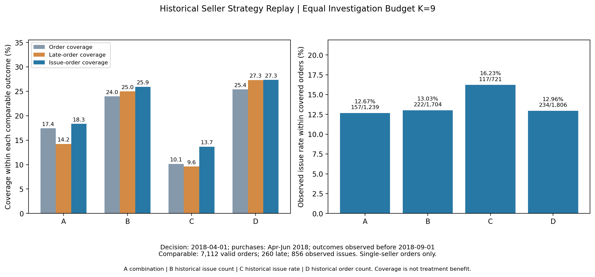

# 卖家调查优先级：有限名额下的策略取舍

## 1. 业务背景

平台运营无法同时调查所有卖家。单看高差评率可能选中规模较小的卖家，单看问题数量又可能主要选中大卖家。本案例比较相同调查名额下，不同名单在后续订单中覆盖了多少可观察履约与客户体验问题，为调查资源配置提供依据。

**实际结果：本次组合规则没有超过简单数量排序。按历史总订单量排序覆盖的问题数量最多，按历史问题占比排序的名单则有更高的问题发生比例。** 

## 2. 决策目标与约束

- 决策时间固定为 **2018-04-01 00:00**，时间戳沿用原数据的无时区时间基准，不擅自转换时区。
- 共同比较资格：决策时已经观察到至少 **100 笔有效已交付单卖家订单**，且至少有一笔当时可用的单条有效评分订单。订单数与评价数分母不同。
- 历史画像含 **2,014 名卖家、59,783 笔订单**，其中 **58,298 笔**有当时可用的单条评分；**130 名**满足资格，覆盖 **33,495 笔**历史订单（全部历史有效单卖家订单的 **56.03%**）。100 笔门槛可行，未调整。
- A 按原组合形式实际得到 **K=9**；B/C/D 各选 **9 名**。原完整历史分析也有9名候选只是人数巧合，不继承原名单或用未来人数补齐。
- 只比较四种策略，不增加有利于某种结论的基线，不按后续是否仍营业过滤名单。调查预算假设每个卖家占一个名额，实际调查工时未观测。

## 3. 候选策略及逻辑

所有策略从相同的130名合资格卖家出发。

- **A 组合规则**：先保留延迟率、有效评价差评率均严格高于历史整体订单加权基准的卖家，再取去重问题订单数量前5与问题占比前5的并集。本次双高卖家35名。双高门槛是A的策略组成部分，共同准入门槛仍为100笔及有可用评价。
- **B 历史问题数量**：在共同资格池内按历史去重问题订单数量降序取K名，侧重既有问题规模。
- **C 历史问题占比**：在共同资格池内按历史问题订单数/有效订单数降序取K名，侧重比例异常。
- **D 历史总订单量**：在共同资格池内按有效订单数量降序取K名，侧重业务覆盖规模。

本次历史整体延迟率基准为 **6.02%（3,598/59,783）**，历史有效评价差评率基准为 **12.23%**。两者均用截止日前可观察样本重新计算，未沿用全历史的6.85%/12.33%，也未使用后续总体阈值。


问题订单仍定义为 **配送延迟或有单条有效低评分（≤2分）** 的并集。未知评价不视为良好评价，但未观察到低分时不能凭空记差评；仅有已观察延迟的订单仍可记为问题订单。

## 4. 数据范围、时间切分与信息可得性

**选人历史**：下单时间在2018-04-01之前，且收货时间也在此前，完整下单/收货/预计日期有效，收货不早于下单，订单最终快照状态为delivered；订单项聚合后恰有一个不同卖家，沿用原项目定义。历史采购队列共66,638笔，单卖家采购65,269笔，其中59,783笔已满足上述结果可观察条件。

单卖家历史采购队列中，**3,814笔最终交付发生于截止日及以后**，没有用它们尚未产生的送达结果选人。其余差额还包含非delivered状态和缺失/异常日期。不能把这些未进入已交付样本的订单当作没有问题。

**评价可得性**：同时检查调查生成日期`review_creation_date`及回答时间`review_answer_timestamp`。只在两者均早于观察截止、回答不早于调查生成/下单、生成日期不早于下单日时，将评分视为可用。生成日期是日粒度，使用下单日比较。然后按当时可见评价记录重新判断“恰好一条且评分非空”，不使用全量记录数提前排除未来才出现第二条评价的订单。缺时间或时间倒置记录不作为已知评分。

历史采购队列里有4,156条评价在截止日尚不可用；历史有效订单中1,485笔没有当时可用的单条评分。评价在最终送达前产生并不自动无效，沿用原研究对客户体验的定义；缺失与多评价情况单列审计，不把未知评分当作非差评的证据。

**后续评估**：下单时间为 **2018-04-01（含）至2018-07-01（不含）**，结果观察统一截止 **2018-09-01（不含）**。固定观察点给6月末订单约两个月成熟时间；评价与送达均按同样的事件时间规则截断。观察点不是看完排名后选择的参数，未针对后续结果调整100笔门槛、历史基准、名单或K。

后续共19,979笔采购；其中19,602笔为单卖家采购，19,296笔满足有效已交付且已观察条件，其余306笔未进入结果分母。19,296笔中有815笔延迟、2,347笔可观察问题订单。

130名历史合资格卖家中，122名在后续有有效已交付订单，8名没有；没有剔除这8名再选人。共同资格池后续采购7,211笔，**7,112笔**进入有效已交付比较，99笔未进入；可用单条评价覆盖率 **99.25%**。资格池只覆盖全体后续有效单卖家订单的36.86%，不能将池内覆盖率说成全平台覆盖率。四份名单各自9名卖家在后续均仍有订单。

**验证等级与限制**：已完成严格截断送达/评价事件时间的时间切分比较，但原数据是最终快照，没有订单状态、商品卖家归属、金额、评分修改及预计日期修订日志。历史中确有 **6笔已记录送达、最终状态却非delivered** 的单卖家订单，按原口径排除，无法还原其决策日状态。因此本案例明确定位为 **事件时间约束的回顾性时间外比较**；**没有达到可保证所有字段真实点时可得的前瞻预测验证标准，不作预测性优劣结论**。订单项在下单时已知且不再修订、回答时间代表评分可用时间，都是受数据结构限制的假设。


## 5. 策略对比结果

四个方案预算均为9名卖家。以下覆盖率分母为共同资格池的 **7,112笔有效订单、260笔延迟订单、856笔问题订单**；问题订单涉及金额共 **R$136,183.86**。所列“问题率”的分母则为各名单自己覆盖的有效订单，体现问题密度。

| 策略 | 后续订单（订单覆盖率） | 延迟订单 | 问题订单（问题覆盖率） | 覆盖订单的问题率 | 问题订单涉及金额 R$ | 后续有有效订单卖家 |
| --- | ---: | ---: | ---: | ---: | ---: | ---: |
| A 组合规则 | 1,239（17.42%） | 37 | 157（18.34%） | 12.67% | 21,179.29 | 9/9 |
| B 历史问题数量 | 1,704（23.96%） | 65 | 222（25.93%） | 13.03% | 30,579.66 | 9/9 |
| C 历史问题占比 | 721（10.14%） | 25 | 117（13.67%） | 16.23% | 22,987.97 | 9/9 |
| D 历史总订单量 | 1,806（25.39%） | 71 | 234（27.34%） | 12.96% | 32,340.36 | 9/9 |



图左同时展示订单覆盖、延迟覆盖和问题覆盖；图右展示覆盖订单内的问题率与分子/分母。金额没有混入百分比轴。

历史选中订单量也不同：A为4,926笔、B为8,430笔、C为2,123笔、D为8,721笔。因此，D/B的覆盖优势有明显规模因素，不能仅凭问题数量认定其风险识别能力更好。

若分母扩大到全部后续有效单卖家订单的2,347笔问题订单，A/B/C/D覆盖率分别为 **6.69% / 9.46% / 4.99% / 9.97%**，明显低于池内覆盖率。

名单重合：A与B/C/D分别重合4/5/4人；B与D重合8人（Jaccard=80%），B与C、C与D各重合1人。不同名单存在较大重合，不是独立实验组，未宣称这些差异具有统计显著性。

原始汇总：[策略结果](../outputs/seller_strategy_comparison.csv)、[名单重合度](../outputs/seller_strategy_overlap.csv)、[样本及时间审计](../outputs/seller_strategy_audit.csv)。均不含订单/客户明细、原始卖家ID或映射。

## 6. 结果解释：不同目标下的取舍

- **要让少数调查名额涉及更多问题订单**：在本次回顾样本里D覆盖234笔，B覆盖222笔，均超过A的157笔；D同时覆盖最多订单与延迟订单。D是本轮覆盖目标下值得保留的简单基线，而非已证明未来最优的方案。
- **要寻找问题比例更突出的对象**：C覆盖订单问题率16.23%，高于A/B/D的12.67%/13.03%/12.96%，但仅覆盖117笔问题订单。它适合比例异常的专项调查思路，代价是较低的数量覆盖及更多小规模波动风险。
- **组合策略的真实表现**：A兼顾双指标偏高与规模/比例，却未在本次覆盖数量、问题率或涉及金额上形成优势；没有为它补人、调阈值或挑有利指标。它提供明确的筛查逻辑，但不能凭规则更复杂就认定更有效。
- **金额是另一种规模视角**：D涉及R$32,340.36，B为R$30,579.66；C虽然问题数更少，涉及金额R$22,987.97仍高于A的R$21,179.29。金额包含商品价格和运费，不能解释成损失、可挽回收益、真实收款或调查回报。

## 7. 调查建议

以下交运及评价指标属于后续订单的**事后解释**，没有参与4月1日选人；不能作为当时已知事实反填到筛选过程。

- **规模覆盖调查**：本次可把D/B作为覆盖面较大的调查清单参考。D有71笔后续最终延迟，其中59笔在有效交运样本中已按时交运（83.10%），提示应核查后续运输轨迹、目的地及承诺日期，不能仅要求卖家加快发货。
- **比例异常专项调查**：C有效交运719笔，其中84笔交运超期（11.68%）；25笔最终延迟中12笔按时交运、13笔交运已超期。交运和后续配送都应核查，不能仅凭该交叉统计判定责任。
- **客户体验调查**：C的105笔差评中有92笔发生于最终准时订单；D的199笔差评中有163笔发生于准时订单。调查需补充商品完整性、商品信息和售后记录，评分与完整交付的关系未在本实验中重新开展文本分析或回归。

有限资源下应先明确希望覆盖数量还是发现比例异常，再确定清单；本案例未模拟或声称已经实施整改，也未把事后问题覆盖当作可避免问题数量。

## 8. 局限、复现与后续验证

- 只有一个决策点和一个季度；没有置信区间或多期稳定性证据，也没有调查成本、干预或对照组，不能证明因果效果和实际收益。
- 结果分母仅为已观察到的有效已交付订单，未完成和异常状态不属于同一风险指标；评价有选择性缺失。历史临近截止日未送达的3,814笔单卖家订单被截断，可能令历史画像偏向较早完成的订单。
- 100笔门槛降低小样本波动，但会遗漏新卖家和小卖家；没有根据后续结果选择门槛，不能声称其最优。
- 后续若验证前瞻性，应先取得真实版本化快照，冻结时点特征与名单，再用多个未来窗口评估覆盖、单位调查工时及经对照试点确认的改善；这是建议，不是已经完成的成果。

本次仅新增卖家策略实验，没有重跑原地区EDA或差评回归；原完整历史的9名候选、原统计结论和5张图保留。原`docs/release_manifest.md`对应首次45文件版本，本次增量由独立分支的Git差异及本报告说明。

在仓库根目录准备本地原始CSV后运行（CSV目录自行设置，不写入仓库）：

```powershell
$env:OLIST_RAW_DIR = '自行下载的CSV目录'
python python/08_seller_strategy_comparison.py
python -m unittest discover -s tests -p 'test_seller_strategy_comparison.py' -v
```

也可用`--raw-dir`、`--output-dir`和`--figure`指定本地输入及输出。脚本只读取订单、商品明细及评价三张表的必要字段；不读取评论原文，不保存卖家名单或ID映射。默认写出三份匿名汇总CSV和一张图，不覆盖旧分析结果。新增的五项测试检查时间边界、未来第二条评价、未来结果扰动、问题并集与共同预算；真实数据另通过截断不变性及分币金额/并集核对。
